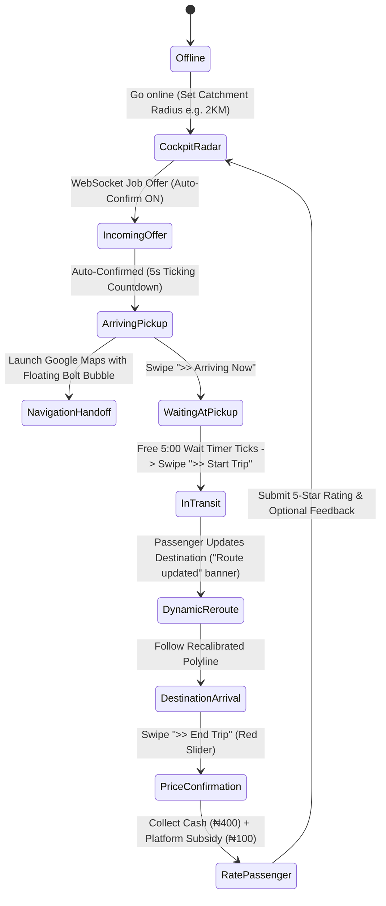

# Bolt Driver App: Active Trip Lifecycle & Real-Time Dispatch Architectural Analysis

> **Source Video:** `VideoEditor_20261123_115243_(2).mp4` (Duration: **11m 07s** / 667s, 360x360 @ 30fps)  
> **Market Context:** Bolt Driver Production App in **Warri, Delta State, Nigeria**  
> **Analysis Date:** November 23, 2026  
> **Author:** Antigravity Engineering Architecture Team

---

## 1. Executive Summary: Core Distinction from Video 1

While the first video highlighted **Driver Administrative, Financial Ledger, and Performance Hubs** (Weekly Earnings Analytics Bar Chart, Liquid Balance vs Gross Ledger, Minimum Early Cashout Threshold of ₦1,000, Campaigns Checklist, Driver Score Deductions, and Destination Corridor Filter), this second video reveals the **Live Mission Core & Active Trip Execution Lifecycle** of the Bolt Driver platform in Nigeria.

The recording demonstrates an end-to-end real-time trip execution, from configuration and going online, to receiving an auto-confirmed dispatch offer, navigating to pickup, waiting for the passenger with an active countdown clock, starting the trip, handling a dynamic mid-trip destination change by the passenger, navigating to the new dropoff, collecting physical cash with platform promotional compensation, and rating the rider.



---

## 2. Phase-by-Phase Architectural Analysis

### Phase 1: Configuration, Driver Safety Guardrails & Theme Switcher (00:00 – 02:45)
*Corresponding Frames: `#1` to `#24`*

#### A. Auto-Confirm Policy & State Machine Fail-Safe
- **Screen:** `Auto-Confirm` (under App Settings).
- **Core Toggle:** Single master toggle `Auto-Confirm (ON/OFF)`.
- **System Policy Text:**
  - *"Incoming trip requests will be confirmed automatically."*
  - *"Auto-Confirm will be disabled when you decline, cancel or miss a trip request."*
- **Architectural Significance:** This is a mission-critical safety feature. In urban Nigerian traffic (e.g., Warri roundabouts or Lagos expressways), hands-free dispatch prevents drivers from taking their eyes off the road. However, if a driver intentionally declines or misses a trip, the system immediately revokes Auto-Confirm to prevent unintended orders from piling up on an occupied or inattentive driver.

#### B. App Settings Hierarchy
- **Quick access:** Floating widget overlay (`Lock On / Widget On`).
- **Auto-Confirm:** Status indicator (`On`).
- **Theme:** Selector modal offering `System default`, `Dark`, and `Light`.
  - The video demonstrates switching to `Dark` mode (Frame `#17`), showcasing a night-mode vector map that reduces glare and power consumption on OLED displays.
- **Language:** Fixed locale identifier (`English, United Kingdom, GB`).

#### C. Support Hub & Recent Ride Context
- Driver: `Evans King` (Phone: `+234 703 312 991`, Email: `evanskings@gmail.com`).
- Dedicated support ticketing integrated with the latest trip history:
  - Header: *"How can we help?"*
  - Recent ride card: `1 Airport Road, Warri 330102 - Finished • ₦600` (allowing 1-tap dispute filing directly attached to the order ID).
  - Categorized help: *Account*, *Earnings and payments*, *Trip issues*.
  - Bottom Passenger cross-promotion: *"Want to request a trip? Get passenger app"*.

---

### Phase 2: Dynamic Catchment Radar & Going Online (02:48 – 03:25)
*Corresponding Frames: `#25` to `#30`*

- **Location:** Warri, Delta State, Nigeria (Effurun / Airport Road axis).
- **Dispatch Catchment Radius Widget:**
  - The map renders a pulsing emerald circular geofence centered on the driver's vehicle.
  - A bottom radius control chip: `2KM` flanked by `+` and `-` buttons.
  - **Engineering Value:** Allows drivers to limit dispatch requests to dense local areas (e.g., within 2 km) when fuel is low or traffic is heavy, or expand the radius up to 5 km or 10 km during off-peak hours.
- **Top Status Indicator:** Orange pill: `Go offline` indicating an active, available background polling session.

---

### Phase 3: Live Dispatch Offer & Hands-Free Auto-Confirmation (03:30 – 04:05)
*Corresponding Frames: `#31` to `#36`*

#### A. Incoming Offer Sheet
- **Top Right Dismissal:** `X Decline` button with acceptance rate warning.
- **Visual Palette:** Bolt Vibrant Emerald (`#00A859` / `#23C16B`) card.
- **Trip Metadata Display:**
  - Distance & ETA: `6 min • 170 m`
  - Pickup Address: `78 Airport Road`
  - Detailed Landmark: `Opposite Delta Mall, Effurun Roundabout, Warri, Nigeria`
  - Passenger Details: `Base • Ebi 5.0 ★`
  - Payment Method Pill: `💵 Cash`
- **Auto-Confirm Countdown:**
  - Full-width emerald action bar with white text `Auto-Confirm`.
  - Animated horizontal countdown progress bar ticking down from 5 seconds.

#### B. Auto-Confirmation Toast Banner (Frame `#32`)
- Instant confirmation triggers a deep-blue top toast notification:
  > **⚡ Request was auto-confirmed**  
  > *Passenger is waiting for you to arrive.*

---

### Phase 4: En Route to Pickup & Route Details Sheet (04:05 – 04:35)
*Corresponding Frames: `#33`, `#37` to `#40`*

- **Map Display:** Route polyline rendered from vehicle position to `78 Airport Road`.
- **Floating Controls:**
  - Top-right Google Maps icon (quick navigation handoff).
  - Recenter / bearing compass icon.
  - In-app passenger chat bubble with unread badge.
- **Bottom Summary Card:**
  - ETA: `3 min`
  - Address: `78 Airport Road, Warri 330102`
  - Passenger Name: `Ebi`
  - Primary Action: Tactile green slider: **`>> Arriving Now`**.
- **Route Details Expanded Sheet (Frame `#40`):**
  - Tapping the hamburger list icon expands a modal sheet:
    - Passenger card with `Contact Ebi`.
    - `Show ride details`.
    - `X Cancel trip` (with cancellation reason checklist).
    - `🛑 Stop new requests` (disables back-to-back consecutive dispatch stacking).

---

### Phase 5: External Navigation Handoff Architecture (04:40 – 05:20)
*Corresponding Frames: `#41` to `#46`*

- **Transition State:** "Finding best route..." with centered vehicle icon.
- **Turn-by-Turn Guidance in Google Maps:**
  - Top guidance banner: `↑ Head east`, microphone search, audio mute toggle.
  - Speedometer: `0 km/h`.
  - ETA chip: `1 min (170 m • 10:41)`.
- **The Bolt Floating Bubble / Screen Overlay Widget:**
  - An anchored circular floating widget (`Bolt`) sits persistently on top of Google Maps.
  - Tapping this bubble returns the driver instantly to the Bolt Driver app without navigating through the Android system task switcher.

---

### Phase 6: Passenger Waiting State & Free 5-Minute Countdown Clock (05:22 – 06:55)
*Corresponding Frames: `#47` to `#60`*

When the driver arrives at the pickup point and swipes `>> Arriving Now`, the system transitions to the **Waiting State**:

#### A. Free Wait-Time Counter Clock
- The bottom card replaces the ETA with a descending clock:
  - `04:56 Waiting` → `04:49` → `04:35` → `04:00` → `03:32 Waiting`
- **Regulatory Rule in Nigeria:** Bolt provides **5 minutes (05:00) free waiting time**. If the passenger does not show after 5:00, paid wait-time per minute kicks in, or the driver is granted the option to cancel with a guaranteed cancellation payout without penalty to their Driver Score.

#### B. Primary Action Switch
- The action button transforms from `>> Arriving Now` into a bright green tactile slider:
  > **`>> Start Trip`**

---

### Phase 7: Trip Started (In-Transit) & Safety Red Slider (07:00 – 07:50)
*Corresponding Frames: `#61` to `#68`*

- Driver swipes `>> Start Trip` once passenger enters vehicle.
- **Initial Destination:** `Shoprite Delta Mall, Effurun Roundabout, Warri, Nigeria` (ETA: `18 min`).
- **Tactile Color Inversion (Safety Engineering):**
  - The action button turns from **Emerald Green** to **Solid Coral/Red**:
    > **`>> End Trip`**
  - **Why this matters:** In mobile UI ergonomics, keeping the button green risks muscle-memory accidental double-swiping. Changing to red forces cognitive awareness that swiping this button will permanently conclude the trip and trigger payment collection.

---

### Phase 8: Dynamic Mid-Trip Rerouting (07:56 – 08:05)
*Corresponding Frames: `#69` to `#70`*

In Frame `#69`, the passenger updates their destination in their passenger app while the trip is already in progress:
- **Instant Blue System Banner:**
  > **📍 Route updated**  
  > *Destination has been changed*
- **Automatic Recalibration:**
  - Destination changes from *Shoprite Delta Mall* to **`NNPC Junior Staff Club, Warri, Nigeria`**.
  - ETA recalculates immediately from `18 min` down to **`3 min`**.
  - Polyline on map dynamically reroutes to the new coordinates without requiring any manual interaction from the driver.

---

### Phase 9: Multichannel In-App Communication Hub (08:10 – 09:10)
*Corresponding Frames: `#71` to `#79`*

Tapping `Contact Ebi` opens the **Contact Options Modal**:
1. **`💬 Send a message`:** Built-in WebSocket chat for free messaging.
2. **`📞 Call in-app`:** WebRTC VoIP audio call using data bundles (keeps passenger and driver phone numbers completely anonymous).
3. **`📱 Call by phone`:** Direct cellular GSM dialer launch (essential in Nigeria when data networks drop or 3G/4G coverage fluctuates).
- Regulatory note at top: *"Carrier rates may apply. Do not talk or text while driving."*

---

### Phase 10: Cash Collection & Platform Promo Subsidy Settlement (10:02 – 10:20)
*Corresponding Frames: `#87` to `#89`*

Upon reaching `NNPC Junior Staff Club`, the driver swipes `>> End Trip`. The app presents the **Confirm Price** modal:

```
+--------------------------------------------------------+
|                      Confirm Price                     |
|              [ Trip with compensation ]                |
|                                                        |
|                       N 400.00                         |
|                                                        |
|  +--------------------------------------------------+  |
|  |  Cash ride, collect displayed sum from:          |  |
|  |  Ebi                                             |  |
|  +--------------------------------------------------+  |
|                                                        |
|  Bolt will compensate you                    N 100.00  |
|  ----------------------------------------------------  |
|  Total fare                                  N 500.00  |
|                                                        |
|  [================== >> Confirm ====================]  |
+--------------------------------------------------------+
```

#### Dual-Ledger Cash Subsidy Accounting:
- **Total Gross Fare:** `₦ 500.00`
- **Customer Promo Discount:** `₦ 100.00` (Passenger had a 20% discount coupon applied).
- **Physical Cash Collected:** **`₦ 400.00`** (Driver collects exactly ₦400 from Ebi).
- **Platform Credit to Driver Wallet:** Bolt's backend automatically credits **`₦ 100.00`** into the driver's digital wallet, guaranteeing the driver receives the full `₦ 500.00` gross earnings.

---

### Phase 11: Passenger Rating & Feedback Loop (10:23 – 10:58)
*Corresponding Frames: `#90` to `#95`*

- **Screen:** `Rate passenger`
- **Rating Component:** 5 interactive golden stars (`★ ★ ★ ★ ★`).
- **Feedback Input:** Placeholder `Add a comment` (Driver inputs `"Nice ride"`).
- **Submission:** Tapping green `Confirm` button sends feedback to backend and returns the driver directly to the **Cockpit Map** with the `2KM` green radar scanning for the next dispatch.

---

## 3. Structural Comparison: Video 1 vs Video 2

| Feature / Domain | Video 1 (Admin & Performance Hub) | Video 2 (Active Trip Lifecycle) |
| :--- | :--- | :--- |
| **Primary Focus** | Financials, Profile, Analytics & History | Real-time Trip Execution & Dispatch State Machine |
| **City / Market** | Lagos Mainland / Island | Warri, Delta State (Airport Rd / Effurun Roundabout) |
| **Dispatch Mode** | Idle / Browsing historical records | Live Catchment Radar (`2KM` geofence with `+/-`) |
| **Offer Acceptance** | Manual Inspection of Campaign thresholds | Automatic Auto-Confirm with 5-second ticking timer |
| **Trip Progression** | Static Waybill Review | 5-State Sequential Flow (`Arriving Now` -> `Waiting` -> `Start Trip` -> `End Trip`) |
| **Waiting Logic** | Not shown | Live 5:00 Free Wait-Time countdown (`04:56 Waiting` down to `03:32`) |
| **In-Transit UI** | None | Red action slider (`>> End Trip`) + Live Dynamic Rerouting |
| **Navigation** | Mentioned in settings | Google Maps handoff + Floating Bolt screen overlay bubble |
| **Communication** | Not shown | 3-Tier Contact Modal (`In-App Message`, `VoIP Call`, `Cellular GSM`) |
| **Settlement** | Gross vs Net Weekly Ledger | Immediate Post-Trip Price Confirmation with Cash vs Platform Promo Subsidy |
| **Feedback Loop** | Driver score 92% audit | 5-Star Passenger Rating + Text Comment submission |

---

## 4. Key Takeaways for Bayniks Platform Architecture

To reach 100% parity with this second video, our logistics platform must incorporate:

1. **Auto-Confirm Safety Machine:** An `autoConfirm` store boolean with the strict deactivation rule (auto-deactivates if driver declines, misses, or cancels a trip).
2. **Dynamic Radar Catchment Slider:** A `dispatchRadiusKm` control (`2km`, `5km`, `10km`) visually represented as a concentric wave around the driver's GPS location.
3. **Sequential Color-Coded Sliders:**
   - State 1: Emerald Green `>> Arriving Now`
   - State 2: Countdown Clock `04:59 Waiting...` + Emerald Green `>> Start Trip`
   - State 3: Alert Coral/Red `>> End Trip`
4. **Dynamic Mid-Trip Reroute Listener:** Socket listener for `ORDER_DESTINATION_UPDATED` that triggers the blue "Route updated" toast and recalculates polyline and ETA on the fly.
5. **Floating Overlay Widget (Android Native):** Android system overlay permission (`SYSTEM_ALERT_WINDOW`) enabling the floating courier orb when Google Maps is active.
6. **Cash vs Promo Split Settlement:** Explicit split on the trip completion screen between `Cash collected from customer` and `Compensated by Bayniks (promo discount)`.
7. **Three-Tier Passenger Contact Sheet:** Seamless choice between in-app chat, in-app VoIP, and external GSM cellular dialer.

