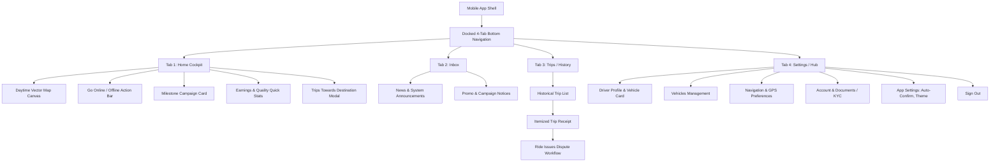
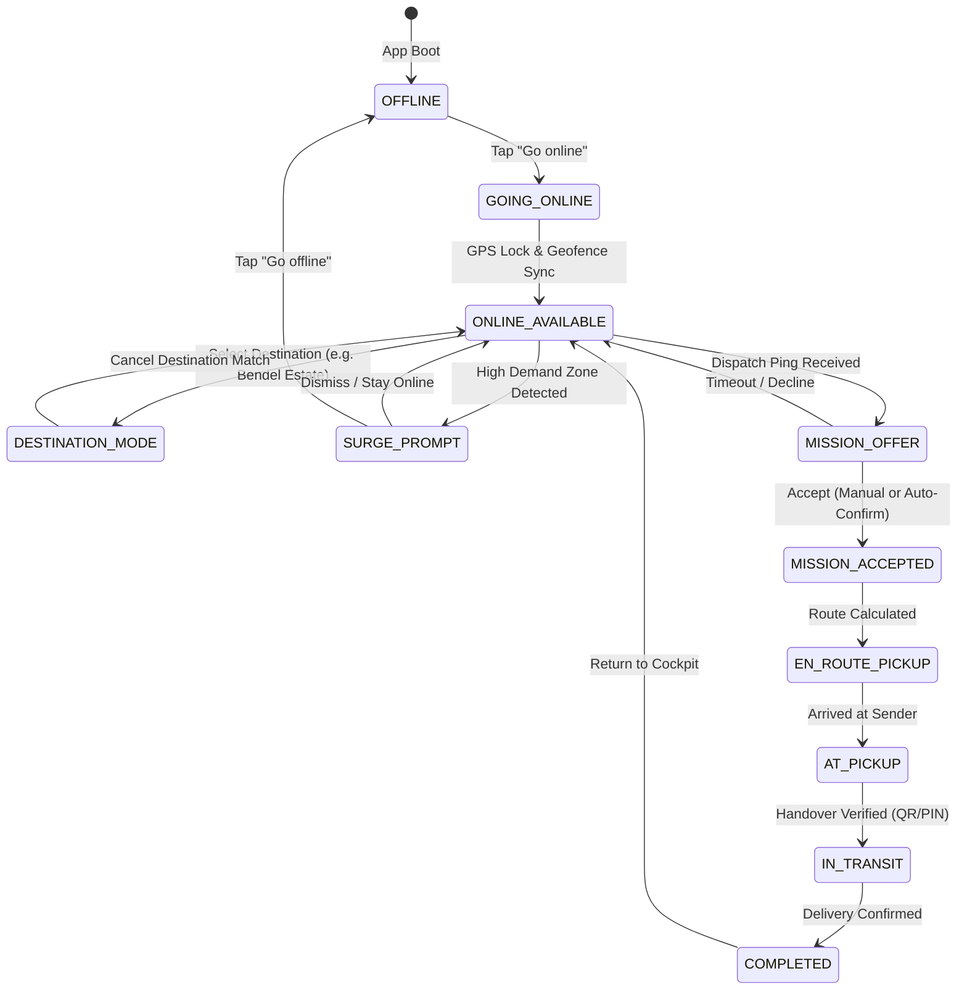
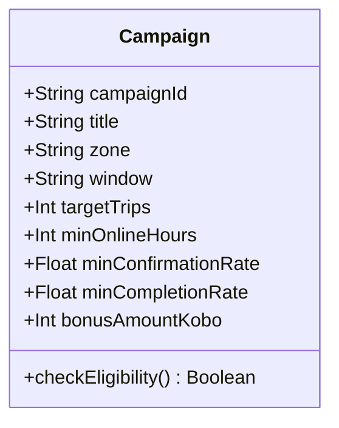

# Deep Architectural Analysis: Bolt Rider Mobile Platform
**Source Telemetry:** 10m 20s Screen Recording (`media_1795433643211_c54f7b42.mp4`, 18,626 frames)  
**Operating Environment:** Nigerian Market (Warri & Lagos, NGN Currency `₦`)  
**Theme:** Daytime Light Mode High-Contrast UI  

---

## Executive Summary

The screen recording provides an exhaustive, end-to-end breakdown of the production **Bolt Driver / Rider mobile application** operating within Nigeria. The architecture is engineered around three core operational tenets:
1. **Low Cognitive Load in Motion:** Clean light mode UI, high-contrast typography, large touch targets, and full-width action toggles.
2. **Strict Operational State Machines:** Clean transitions between Offline, Online/Available, Destination Match Mode, and Mission In-Flight.
3. **Decoupled Financial Architecture:** Complete segregation between **Gross Revenue Analytics** (Earnings) and **Real-Time Liquid Settlement** (Balances/Wallet), backed by automated weekly payouts and instant cashout thresholds.

---

## 1. Information Architecture & Navigation Shell

### Key Architectural Patterns Observed
- **Fixed 4-Tab Docked Bottom Navigation:** The app uses a persistent 4-tab bar (`Home`, `Inbox`, `Trips`, `Settings`) for predictable top-level navigation.
- **Contextual Bottom Sheets for Transient Flows:** Secondary workflows (Destination filters, Campaign details, Ride issue disputes, Cashout sheets) slide up over the active context rather than pushing deep navigation stacks, allowing instant dismissal back to the operational cockpit.
- **Settings as the Dedicated Administrative Hub:** Unlike naive designs that crowd the sidebar or home screen with KYC, vehicle specs, and logouts, Bolt cleanly isolates all legal, regulatory, vehicle, and authentication tools under `Settings`.

---

## 2. Cockpit Architecture & Operational State Machine

### Key Cockpit Features in the Video:
1. **Full-Width "Go online" Action Bar:**
   - In offline state: Bright green/contrast bar with prominent chevrons (`>> Go online`).
   - In online state: Displays live matching telemetry, geofence radius (2km zone), and transforms into a pause/offline trigger.
2. **Destination Mode ("Trips towards destination"):**
   - Limits rider trips along a pre-configured homeward corridor (e.g. `Home: Bendel Estate`, `Favourite: Jakpa Road`).
   - Caps usage at **2 uses per day** (`2 of 2 remaining today`) to prevent abuse while providing riders guaranteed homeward fares.
3. **High-Demand / Surge Prompts:**
   - Detects demand spikes and serves contextual alerts: *"Higher rates! Now is the best time to earn."* with two distinct choices (`Stay online` vs `Go offline`).

---

## 3. Financial Ledger & Settlement Engine

A major architectural highlight revealed in the recording is Bolt's **dual-ledger financial segregation**:

| Feature Domain | **Earnings Tab (Analytics)** | **Balances Tab (Wallet / Escrow)** |
| :--- | :--- | :--- |
| **Purpose** | Performance reporting & turnover analytics | Real-time liquid cash, debt, and payouts |
| **Data Scope** | Daily, Weekly, Monthly filters | Real-time balance snapshot (`₦379`) |
| **Visualisation** | Interactive bar charts (Mon - Sun turnover) | Itemized balance movement breakdown |
| **Deductions** | Displays Gross Earnings, Expenses (Platform Fee), and Net Income | Reconciles Cash collected vs Platform subsidy |
| **Cashout Trigger**| Read-only metrics | **`Early cashout`** button (Instant payout) |
| **Payout Rules** | Historical accounting records | Threshold enforced: Minimum `₦1,000` to cashout |

### Platform Promo Subsidy Reconciliation:
In Frame #50 (`Trip Receipt`), the fare shows:
- **Cash payment:** `₦600`
- **Customer paid:** `₦400`
- **Compensated by Bolt:** `₦200`

> [!IMPORTANT]
> **Architectural Law:** When the customer uses a platform discount code or promotional voucher, the rider’s wallet ledger must credit the compensation amount (`₦200`) instantly so the rider never absorbs platform marketing discounts.

---

## 4. Incentive & Gamification Architecture (Campaigns Engine)

The recording showcases how Bolt drives rider supply retention through a multi-tier **Campaigns Engine**:

### Campaign Tiers Documented:
1. **Morning Rush Bonus:** `₦1,500` for 6 trips during morning peak (07:00-11:59).
2. **All Day Bonus:** `₦1,500` for 6 trips + 6 online hours.
3. **Weekend Surge Bonus:** `₦4,200` for 21 trips + 21 online hours across Friday to Sunday.
4. **Strict Quality Gates:** Every bonus enforces **$\ge 85\%$ confirmation rate** and **$\ge 85\%$ completion rate** to eliminate cherry-picking.

---

## 5. Driver Score, Quality Telemetry & Anti-Fraud

In Frames #19 - #26, the video details Bolt's **Driver Score (92%) & Activity Telemetry**:

1. **Driver Score Calculation:**
   - Computed dynamically over a rolling window of the **past 100 journeys**.
   - Sub-penalties transparently displayed:
     - `Cancellation rate: 6%`
     - `Passenger cancelled before pickup: 1%`
     - `Passenger feedback: 1%`
     - `Bad behaviour: 1%`
2. **Activity Telemetry Dashboard:**
   - **HOURS Tab:** Visualizes weekly online hours (e.g. `30h 31m`) broken down day-by-day.
   - **TRIPS Tab:** Tracks completed vs requested trips (`9 / 12`).
   - **CANCELS Tab:** Deep analytics on the past 50 cancelled trips:
     - `Passenger cancelled (80%)` vs `Rider cancelled (16%)` vs `Unconfirmed (4%)`.
     - Behavioral guidance cards (*"Call before you cancel"*, *"Be ready to accept bookings"*).

---

## 6. Post-Trip Dispute Resolution & Support Workflows

When a rider completes a trip or experiences issues, they don't submit a generic support ticket. Instead, every ride receipt has a contextual **`Get help with ride >`** trigger with parameterized dispute flows:
- **Passenger did not pay or paid less:** Directly triggers a payment shortfall investigation with automated rider balance adjustment.
- **Price lower than expected:** Recalculates GPS route mileage and traffic delay toll.
- **Passenger complaint / conduct:** Flags sender/passenger account.
- **Lost & found item:** Initiates safe handover protocol.

---

## 7. Comparative Gap Analysis: Bolt vs Bayniks Logistics

| Feature / Architecture Domain | **Bolt Driver Production App** | **Bayniks Logistics Current State** | **Recommended Implementation** |
| :--- | :--- | :--- | :--- |
| **Cockpit Layout** | Light mode map, floating white circles, black/orange action bar, bottom cards | ✅ Fully implemented in Stage 2/Rider Cockpit | Maintained |
| **Navigation Shell** | Docked 4-Tab Bar (`Home`, `Inbox`, `Trips`, `Settings`) + Left Drawer | ✅ Left Drawer + Docked Bottom Nav (`Home`, `Earn more`, `Rides`, `Help`) | Add `Inbox` communications tab |
| **Settings Hub** | Centralized KYC, vehicle, navigation, auto-confirm, and logout | ✅ All moved to Settings subview in `RiderNavigationDrawer` | Add Vehicle Multi-fleet selector |
| **Financial Ledger** | Split `Earnings` (analytics) and `Balances` (liquid wallet & cashout) | ✅ In-App Paystack TopUp & Instant Cashout supported | Implement Dual-Tab Ledger (`Earnings` vs `Balances`) |
| **Campaigns Engine** | Real-time milestone tracker (`0/6 trips`, `₦1,500 bonus`) | ✅ Bonus card displayed on cockpit & profile | Add multi-tier campaign schema & auto-bonus payout |
| **Destination Filter** | 2/day corridor matching towards saved home address | ⚠️ Full radar map with 10km radius | Implement Corridor Geofence search in Redis |
| **Itemized Ride Receipts**| Map snapshot, cash vs promo compensation, dispute links | ✅ Waybill delivery history implemented | Add parameterized ride issue dispute sheet |
| **Auto-Confirm Dispatch**| Toggle in App Settings for hands-free dispatch acceptance | ⚠️ 30-second timer sheet accept/decline | Add auto-confirm toggle to rider store settings |

---

## Conclusion & Strategic Roadmap

The Bolt rider app is a masterclass in **frictionless driver ergonomics**. Its architectural strength lies in:
1. **Clean contextual segregation:** Operational tools on the map, financial analytics in Earnings, liquid money in Balances, and administrative paperwork in Settings.
2. **Transparent gamification:** Riders always know exactly how many trips and hours remain to unlock their cash bonuses.
3. **Empowering self-service disputes:** Drivers resolve cash shortages and cancellations directly through parameterized receipt workflows rather than waiting on call centers.

These architectural patterns will serve as the master blueprint for Bayniks Logistics.

