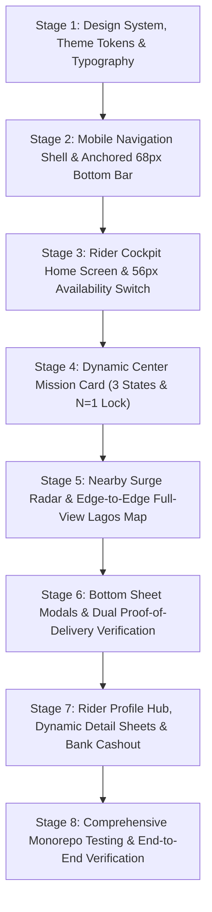

# BAYNIKS Rider App — Complete UI/UX Redesign Blueprint & Staged Execution Plan

> **Master Design Reference:** `bayniks_rider_edition.html`  
> **Target Package:** `apps/rider-apk` (React 18 + Vite + Tailwind CSS + Zustand + Lucide Icons)  
> **Platform Target:** Responsive Mobile Viewport (Max-width: 430px, 100dvh — iPhone 14/15 Pro & Modern Android Handsets)  
> **Design Philosophy:** Atomic, glove-friendly tactile mobile cockpit, strict N=1 mission capacity lock, dual Proof-of-Delivery verification (QR camera scanner + 4-digit recipient OTP keypad), real-time Lagos corridor telemetry, and high-contrast dual theme system (Light Default / Obsidian Dark).

---

## 1. Architectural Overview & System Design Tokens

### A. Strict Color Palette & Surface Tokens
All styling will be bound directly to CSS variables and Tailwind extensions to support instant Light / Dark mode switching.

| Token Variable | Light Mode (Default) | Dark Mode (`[data-theme="dark"]`) | Usage / Applied Element |
| :--- | :--- | :--- | :--- |
| `--backdrop-outer` | `#E6E9EF` | `#070A0F` | Outer desktop viewport letterbox container |
| `--bg-canvas` | `#F5F6F8` | `#0F131A` (Obsidian) | Mobile app scrollable viewport stage |
| `--bg-card` | `#FFFFFF` | `#171E2B` (Slate) | Surface cards, bottom sheets, navigation bar |
| `--bg-subcard` | `#F8F9FA` | `#212B3E` (Lifted Slate) | Route subcards, checklist items, input backgrounds |
| `--bg-input` | `#F1F3F5` | `#212B3E` | Input text fields & select boxes |
| `--border-color` | `#E2E8F0` | `rgba(255, 255, 255, 0.09)` | Standard container & card borders |
| `--border-subtle` | `#EDF2F7` | `rgba(255, 255, 255, 0.06)` | Inner dividers and list separators |
| `--text-primary` | `#11151E` | `#F8FAFC` | Primary headings, monetary values, bold labels |
| `--text-secondary` | `#64748B` | `#94A3B8` | Subtitles, route descriptions, inactive icons |
| `--text-muted` | `#94A3B8` | `#64748B` | Micro-labels, chevrons, timestamps |
| `--accent-orange` | `#FF6D1F` | `#FF6D1F` | Primary Brand Atomic Orange, active accents |
| `--accent-orange-hover` | `#EA580C` | `#EA580C` | Pressed/active state on primary buttons |
| `--accent-peach` | `#FFF1E8` | `rgba(255, 109, 31, 0.16)` | Live chips, pill buttons, active switch track |
| `--accent-peach-border` | `rgba(255, 109, 31, 0.30)` | `rgba(255, 109, 31, 0.38)` | Borders on peach tags and pill buttons |
| `--accent-emerald` | `#10B981` | `#10B981` | Online dot, success toasts, verified checks |
| `--accent-emerald-bg` | `#ECFDF5` | `rgba(16, 185, 129, 0.16)` | Verified badges, online status pills |
| `--accent-emerald-text`| `#047857` | `#34D399` | Success text and verified badge labels |
| `--accent-red` | `#EF4444` | `#EF4444` | Emergency SOS card, fragile labels, end shift |
| `--accent-red-bg` | `#FEF2F2` | `rgba(239, 68, 68, 0.18)` | Fragile warning backgrounds, SOS cards |
| `--accent-red-text` | `#B91C1C` | `#F87171` | Emergency SOS headline, fragile banner |
| **Hero Card Base** | `#191615` (Espresso) | `#191615` (Espresso) | Invariant Charcoal-Espresso card with radial glow |
| **Nav Center Orb** | `#22252A` | `#22252A` | Floating quick-scan action orb |

### B. Full-View Map Surface Tokens
| Token Variable | Light Mode | Dark Mode | Geographic Feature |
| :--- | :--- | :--- | :--- |
| `--map-land` | `#EEF1F5` | `#0D121B` | Mainland & Island base topography |
| `--map-water` | `#D4E6F6` | `#0A1B2E` | Lagos Lagoon, Five Cowrie Creek, Bight of Benin |
| `--map-park` | `#DCF2E5` | `#0F231E` | UNILAG waterfront, Ikoyi Golf Course green belts |
| `--map-road-minor` | `#FFFFFF` | `#1B2436` | Local district street grid (Yaba, Surulere, Ikeja) |
| `--map-road-major` | `#CBD5E1` | `#2B3750` | Ikorodu Rd, Western Ave, Ozumba Mbadiwe Exp |
| `--map-bridge` | `#94A3B8` | `#475569` | Third Mainland Bridge, Carter, Eko, Lekki-Ikoyi |
| `--map-label` | `#475569` | `#94A3B8` | District typography (Ikeja, Yaba, Ikoyi, VI) |
| `--map-glass` | `rgba(255, 255, 255, 0.90)` | `rgba(23, 30, 43, 0.90)` | Translucent floating topbar & map FAB controls |

### C. Typography Rules
- **Sans font:** `Plus Jakarta Sans`, sans-serif (weights: 400, 500, 600, 700, 800)
- **Mono / Numeric font:** `Space Grotesk`, monospace (`tabular-nums`, weights: 600, 700)
- **Micro-Labels:** `font-size: 10px`, `font-weight: 800`, `text-transform: uppercase`, `letter-spacing: 0.06em`, `color: var(--text-muted)`
- **Hero Money Display:** `font-size: 23px` / `28px`, Space Grotesk tabular-nums, `font-weight: 700`

### D. Tactile Glove-Friendly Layout Dimensions
- **Shell:** Centered mobile container `max-width: 430px`, `height: 100dvh`, `overflow: hidden`.
- **Buttons:** Height `54px` (`.btn-orange-xl`, `.btn-neutral-xl`), height `46px`–`48px` (secondary actions), height `32px` (`.pill-peach-btn`).
- **Bottom Navigation:** Height `68px`, anchored bottom, z-index `40`.
- **Bottom Sheets:** Border radius top `28px`, backdrop filter blur `5px`, z-index `60`.
- **Full-View Map:** `position: absolute; inset: 0; z-index: 95`, covers 100% viewport and hides bottom nav.

---

## 2. Lucide Icon Mapping Directory

In accordance with strict requirements, all native SVGs are replaced with equivalent, production-grade Lucide icons (`lucide-react`):

| Component / Screen Element | Action / Meaning | Lucide React Icon Component | Size & Stroke |
| :--- | :--- | :--- | :--- |
| **Hero Brand Tag** | BAYNIKS Lightning Bolt | `<Zap />` | `13px`, stroke `2.8` |
| **Hero Theme Toggle** | Light / Dark Mode Toggle | `<Sun />` / `<Moon />` | `14px`, stroke `2.2` |
| **Hero Notification Bell** | Courier Alerts | `<Bell />` | `15px`, stroke `2.3` |
| **Hero Quick Action** | Translucent QR Scan | `<QrCode />` | `16px`, stroke `2.4` |
| **Availability Bar** | Online / Offline Switch | `<Power />` | `18px`, stroke `2.4` |
| **Active Mission: Phone** | Call Sender / Recipient | `<Phone />` | `15px`, stroke `2.3` |
| **Active Mission: Map** | Launch Full Screen Map | `<Navigation />` | `15px`, stroke `2.3` |
| **Active Mission: Fragile** | Fragile Goods Warning | `<AlertTriangle />` | `11px`, stroke `2.4` |
| **Dispatch Offer: Parcel** | 3D Sealed Box | `<Package />` | `16px`, stroke `2.3` |
| **Dispatch Offer: Pickup Pin** | Pickup Location Pin | `<MapPin />` | `16px`, stroke `2.4` |
| **Bottom Nav: Home** | Cockpit Dashboard | `<Home />` | `19px`, stroke `2.2` |
| **Bottom Nav: QR Orb** | Quick Handover Scanner | `<QrCode />` | `20px`, stroke `2.3` |
| **Bottom Nav: Profile** | Rider Settings Hub | `<User />` | `19px`, stroke `2.2` |
| **Full Map: Back Button** | Return to Cockpit | `<ChevronLeft />` | `15px`, stroke `2.5` |
| **Full Map: Recenter GPS** | Center on Rider Puck | `<Crosshair />` | `18px`, stroke `2.3` |
| **Full Map: Collapse Card** | Minimize / Expand Status | `<ChevronDown />` | `15px`, stroke `2.5` |
| **Profile: Avatar Edit** | Edit Profile Picture | `<Pencil />` | `12px`, stroke `2.6` |
| **Profile: Personal Info** | Account Details | `<User />` | `18px`, stroke `2.2` |
| **Profile: Wallet & Pay** | Earnings & Cashout | `<CreditCard />` / `<Wallet />` | `18px`, stroke `2.2` |
| **Profile: Bank Account** | Settlement Account | `<Landmark />` | `18px`, stroke `2.2` |
| **Profile: Vehicle & Docs** | Fleet & Compliance | `<FileText />` | `18px`, stroke `2.2` |
| **Profile: Roadside SOS** | 24/7 Safety Dispatch | `<MessageSquareWarning />` | `18px`, stroke `2.2` |
| **Profile: End Shift** | Sign Out / Go Offline | `<LogOut />` | `18px`, stroke `2.2` |

---

## 3. Sequential Redesign Execution Stages

The redesign is divided into **8 strict, verifiable stages** following the Master Protocol: **BUILD -> TEST -> DEBUG -> VERIFY**.

---

### STAGE 1: Design System, Theme Tokens & Typography
- **Objective:** Configure Tailwind tokens, CSS variables, typography imports, and utility classes in `apps/rider-apk` to match `bayniks_rider_edition.html` down to the exact hex code and border radius.
- **Files to Modify / Create:**
  - `apps/rider-apk/tailwind.config.js` (add custom colors, fonts, shadow tokens)
  - `apps/rider-apk/src/index.css` (implement `--bg-canvas`, `--bg-card`, `--accent-orange`, `--map-*` CSS variables, `@keyframes`, `.surface-card`, `.orange-frame`, `.btn-orange-xl`, `.btn-neutral-xl`, `.pill-peach-btn`, `.tabular-num`, `.micro-label`)
  - `apps/rider-apk/src/utils/audioChimes.ts` (Web Audio API sound generator for dispatch alerts, OTP key taps, and success notifications)
  - `apps/rider-apk/src/components/MobileToast.tsx` (toast notification pill at the top of the viewport)
- **Validation Checklist:**
  - [x] Light theme (`#F5F6F8`) and Dark theme (`#0F131A`) switch smoothly via `document.documentElement.setAttribute('data-theme', mode)` and persist to `localStorage`.
  - [x] Space Grotesk tabular nums render with fixed character width.
  - [x] Audio chimes play properly without external audio file dependencies.
- **Verification Commands:**
  `npm run typecheck --prefix apps/rider-apk`  
  `npm run test --prefix apps/rider-apk`

---

### STAGE 2: Mobile Navigation Shell & Anchored 68px Bottom Bar
- **Objective:** Construct the 430px centered mobile shell and the anchored 68px bottom navigation bar with the Home tab, Central Dark Charcoal QR Orb, and Profile tab.
- **Files to Modify / Create:**
  - `apps/rider-apk/src/components/MobileAppShell.tsx` (centered 430px container with letterbox backdrop)
  - `apps/rider-apk/src/components/MobileBottomNav.tsx` (fixed 68px bottom nav with `.nav-tab-btn`, `.nav-circle-wrap`, and `.nav-center-qr-orb`)
  - `apps/rider-apk/src/store/riderStore.ts` (add navigation screen state: `'home' | 'earnings' | 'support' | 'profile'`)
- **Visual & Functional Requirements:**
  - Bottom bar height: `68px`, background `--bg-card`, border top `1px solid var(--border-color)`.
  - Center QR Orb: `48x48px` diameter, `#22252A` charcoal background, `2px solid #FF6D1F` orange border, white `LucideQrCode` icon, scale `0.92` on touch.
  - Active tab indicators: orange circle fill (`#FF6D1F`) with white icon and bold label.
- **Verification Commands:**
  `npm run typecheck --prefix apps/rider-apk`  
  `npm run test --prefix apps/rider-apk`

---

### STAGE 3: Rider Cockpit Home Screen & 56px Availability Switch
- **Objective:** Build the top half of the Home tab: the signature Espresso-Charcoal Hero Card and the prominent 56px Availability Switch Bar.
- **Files to Modify / Create:**
  - `apps/rider-apk/src/components/HeroEspressoCard.tsx` (radial gradient card with brand bolt, theme pill, live status pill, bell icon, rider avatar, PRO badge, and inner earnings glass box)
  - `apps/rider-apk/src/components/AvailabilityBar.tsx` (56px power toggle bar with animated switch track and thumb)
- **Visual & Functional Requirements:**
  - Hero Card: `background: radial-gradient(circle at 90% 10%, rgba(255, 109, 31, 0.30) 0%, rgba(25, 22, 21, 0) 58%), #191615`.
  - Avatar ring: `linear-gradient(135deg, #FF6D1F, #FB923C)` with initials `JO`.
  - Earnings glass: `₦18,450` in Space Grotesk tabular font + "8 completed deliveries today" + QR Scan action button.
  - Availability Bar: `56px` height, toggle track transforms smoothly to orange when online; strict capacity lock prevents going offline when an active order is in progress.
- **Verification Commands:**
  `npm run typecheck --prefix apps/rider-apk`  
  `npm run test --prefix apps/rider-apk`

---

### STAGE 4: Dynamic Center Mission Card (3 States & N=1 Lock)
- **Objective:** Implement the central mission card (`1.5px solid #FF6D1F`, radius `24px`) supporting all 3 operational states and strict 1/1 capacity locking.
- **Files to Modify / Create:**
  - `apps/rider-apk/src/components/DynamicCenterCard.tsx` (parent dispatcher)
  - `apps/rider-apk/src/components/mission/OfflineStandbyCard.tsx` (State 1: "Go Online to start earning")
  - `apps/rider-apk/src/components/mission/OnlineScanningCard.tsx` (State 2: "Scanning Yaba & VI corridor..." with "Simulate Dispatch ⚡")
  - `apps/rider-apk/src/components/mission/ActiveMissionCard.tsx` (State 3: 4-step stepper, dual route cards, fragile cargo box, checklist, canned SMS, dynamic call button)
- **Visual & Functional Requirements:**
  - Stepper: 4 pill segments with orange fill and glow on active step.
  - Step 1: En Route to Pickup (ETA 6 min) -> Call Sender -> "Arrived at Pickup Location →"
  - Step 2: Parcel Collection -> Displays checkbox inspection checklist -> "Confirm Package Collected →"
  - Step 3: In Transit to Drop-off (ETA 12 min) -> Displays canned SMS chips (`5 mins away`, `At security gate`, `Ready for OTP`) -> Call Recipient -> "Arrived at Destination →"
  - Step 4: Handover Verification -> Displays "Scan QR / OTP Handover →" CTA.
  - Fragile parcel banner: `4.5 kg` weight, red warning tag (`⚠️ FRAGILE`), "Handle with Care • Keep upright & cushion inside 60L box".
- **Verification Commands:**
  `npm run typecheck --prefix apps/rider-apk`  
  `npm run test --prefix apps/rider-apk`

---

### STAGE 5: Nearby Surge Radar & Edge-to-Edge Full-View Lagos Map
- **Objective:** Implement the in-cockpit Surge Radar Card and the full-screen interactive vector map overlay (`#fullMapScreen`, z-index 95).
- **Files to Modify / Create:**
  - `apps/rider-apk/src/components/NearbySurgeRadar.tsx` (175px mini radar with Yaba, Ikeja, and VI surge pins)
  - `apps/rider-apk/src/components/FullMapScreen.tsx` (full-screen overlay covering 100% viewport, hiding bottom nav)
  - `apps/rider-apk/src/components/map/LagosVectorGeography.tsx` (820x960 SVG: Mainland, Lagoon, 3rd Mainland Bridge, Lekki-Ikoyi link, district labels)
  - `apps/rider-apk/src/components/map/FullMapBottomCard.tsx` (collapsible status card with standby and active mission telemetry)
- **Visual & Functional Requirements:**
  - Top Bar: Floating translucent pill with Back button (`LucideChevronLeft`), corridor title, and green pulsing LIVE GPS badge.
  - Controls: Floating vertical FAB stack (`+`, `−`, Recenter `LucideCrosshair`, Surge Toggle `🔥`).
  - Active Mission Route: Double-path SVG curved line across Third Mainland Bridge with animated orange dashing (`stroke-dasharray: 9 6; animation: routeDashFlow 1.1s linear infinite`), Pickup Pin P, and Drop-off Pin D.
  - Rider Puck: Pulsing atomic orange beacon with rider plate tag ("Joseph Okon • BLT-4912"), dynamically animating across mission waypoints.
  - Collapsible card: Chevron toggle minimizes card to a single-line status pill.
- **Verification Commands:**
  `npm run typecheck --prefix apps/rider-apk`  
  `npm run test --prefix apps/rider-apk`

---

### STAGE 6: Bottom Sheet Modals & Dual Proof-of-Delivery Verification
- **Objective:** Build Bottom Sheet 1 (`sheetDispatchOffer` 30s acceptance gate) and Bottom Sheet 2 (`sheetHandoverVerify` dual QR/OTP verification).
- **Files to Modify / Create:**
  - `apps/rider-apk/src/components/sheets/DispatchOfferSheet.tsx` (30s timer bar, ₦3,200 guaranteed pay, route breakdown, 4.5kg cargo details, Accept/Decline)
  - `apps/rider-apk/src/components/sheets/HandoverVerifySheet.tsx` (segmented QR scanner & 4-digit OTP keypad)
  - `apps/rider-apk/src/components/sheets/QrScannerViewfinder.tsx` (corner reticles, sweeping laser beam, camera torch toggle, invariant white QR matrix)
  - `apps/rider-apk/src/components/sheets/OtpKeypad.tsx` (4 digit slots, 3x4 numeric keypad, PIN 7482 validation, error feedback)
- **Visual & Functional Requirements:**
  - Timer: 30-second linear countdown bar shrinking to 0%. If expired, offer closes with toast notification.
  - Invariant QR: `#FFFFFF !important` background container so camera viewfinders retain optical contrast in both light and dark modes.
  - OTP Keypad: Entering `7482` succeeds with audio chime, credits `₦3,200` to wallet, adds trip to history ledger, unlocks capacity (0/1), and displays success toast.
- **Verification Commands:**
  `npm run typecheck --prefix apps/rider-apk`  
  `npm run test --prefix apps/rider-apk`

---

### STAGE 7: Rider Profile Hub, Dynamic Detail Sheets & Bank Cashout
- **Objective:** Build the Profile screen (`screen-profile`), the edit profile modal (`sheetEditProfile`), and all dynamic sub-sheets (`sheetDynamicDetail` for Waybill Audit, GTBank Cash-out, Vehicle & Compliance Docs, Roadside SOS, and Live Dispatch Chat).
- **Files to Modify / Create:**
  - `apps/rider-apk/src/components/RiderProfileScreen.tsx` (top card, 74px avatar, KYC/PRO badges, 3-column stats, grouped menu cards)
  - `apps/rider-apk/src/components/sheets/EditProfileModal.tsx` (phone, email, depot, bank, 10-digit account number)
  - `apps/rider-apk/src/components/sheets/DynamicDetailSheet.tsx` (modular container for waybill receipt, cashout, vehicle docs, SOS, and chat)
  - `apps/rider-apk/src/components/sheets/CashoutDetailView.tsx` (available balance, destination GTBank, amount input, instant transfer)
  - `apps/rider-apk/src/components/sheets/SosSupportDetailView.tsx` (24/7 rapid response, live GPS 6.5165° N, 3.3855° E, broadcast button, chat drawer)
- **Visual & Functional Requirements:**
  - Career Stats: Rating `4.95 ★`, Deliveries `542` (updates dynamically), Acceptance `98.2%`.
  - Cash-Out: Allows entering amount up to wallet balance (min `₦1,000`), deducts immediately with instant settlement record.
  - SOS: Plays alarm tone, displays exact latitude/longitude, dials toll-free line `0800-BAYNIKS`.
  - Dispatch Chat: Displays real-time message bubble stream, canned response chips, and auto-reply dispatcher.
- **Verification Commands:**
  `npm run typecheck --prefix apps/rider-apk`  
  `npm run test --prefix apps/rider-apk`

---

### STAGE 8: Comprehensive Monorepo Testing & End-to-End Verification
- **Objective:** Conduct exhaustive unit, integration, and UI regression testing across all 8 stages, verifying 100% type safety and green test suite.
- **Files to Modify / Create:**
  - `apps/rider-apk/src/__tests__/riderRedesignComplete.test.tsx` (comprehensive test suite covering all states, navigation tabs, bottom sheets, OTP keypad, cashout, and full map)
- **Verification Checklist:**
  - [x] Strict TypeScript check: `npm run typecheck --prefix apps/rider-apk` passes with 0 errors.
  - [x] Vitest test suite: `npm run test --prefix apps/rider-apk` passes with 100% green assertions.
  - [x] Full production build: `npm run build` passes cleanly across the entire monorepo (`packages/ui`, `packages/shared-types`, `apps/rider-apk`, `apps/customer-web`, `apps/backend`).
- **Terminal Proof Delivery:**
  Capture and present terminal verification logs confirming zero linter warnings and clean compilation.

---

## 4. Summary Table of Implementation Stages

| Stage # | Stage Name | Key Deliverables & Components | Primary Verification Metric |
| :---: | :--- | :--- | :--- |
| **Stage 1** | Design Tokens & System | Tailwind colors, CSS variables, typography, audio chimes, toast pill | Token parity & CSS compilation |
| **Stage 2** | Mobile Shell & Bottom Nav | 430px shell, 68px nav bar, `#22252A` QR orb, Lucide icons | Nav tab switching & store sync |
| **Stage 3** | Hero Card & Availability | `#191615` Espresso Card, avatar, earnings glass, 56px power switch | Online/Offline toggle & capacity lock |
| **Stage 4** | Center Mission Card | 3 States (Standby, Scanning, Active Mission), 4-step stepper, checklist | Mission progression Steps 1–4 |
| **Stage 5** | Surge Radar & Full Map | 175px mini radar, `#fullMapScreen`, SVG Lagos geography, route polyline | Map pan/zoom & recenter controls |
| **Stage 6** | Dual POD Verification | 30s offer timer bar, QR reticle viewfinder, 4-digit OTP keypad (`7482`) | Acceptance gate & PIN settlement |
| **Stage 7** | Profile Hub & Sub-Sheets | Profile stats, GTBank cashout, Roadside SOS, Live Dispatch chat | Form edits & instant withdrawal |
| **Stage 8** | Monorepo E2E Verification | Automated test suite, TypeScript strict typecheck, production build | 100% green tests & clean build |

